# PixelCart (QA Cart)

PixelCart is a small online clothing store that I built and run **like a real product team would**, to show how I work as a QA engineer. The app is the system under test. Around it is the full software development life cycle: requirements and sprints in **Jira**, documentation and test cases in **Confluence**, branches and pull requests in **GitHub**, preview, staging and production environments on **Vercel**, and automation that links them together.

| | |
|---|---|
| **Production** (`main`) | https://qa-project-automation.vercel.app |
| **Staging** (`staging`) | https://qa-project-automation-staging.vercel.app |
| **Jira** | Project `PIXEL` (PixelCart QA), Scrum board with sprints |
| **Confluence** | Space `PIXEL` (PixelCart): feature specs, test data, 127 test cases |
| **Stack** | React 19, TypeScript, Vite, Tailwind CSS 4, React Router 7, `localStorage` (no backend) |

<p align="center">
  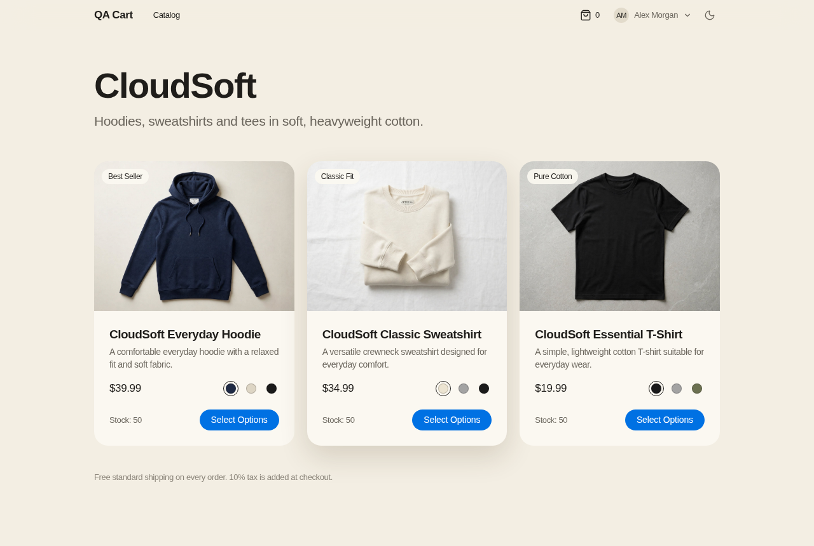
</p>

## Contents

- [Why this project exists](#why-this-project-exists)
- [The app](#the-app)
- [How the work flows](#how-the-work-flows)
- [Jira](#jira)
- [Confluence](#confluence)
- [Test cases](#test-cases)
- [GitHub](#github)
- [Environments on Vercel](#environments-on-vercel)
- [Automation](#automation)
- [Known issues and risks](#known-issues-and-risks)
- [Roadmap](#roadmap)
- [Running it locally](#running-it-locally)
- [Test data](#test-data)
- [`data-testid` reference](#data-testid-reference)
- [Project structure](#project-structure)

## Why this project exists

Most QA portfolios show a list of test cases for someone else's website. I wanted to show the whole job: reading a story, questioning its acceptance criteria, writing test cases before the code is merged, testing on a preview build, following a change from a feature branch to production, and keeping the documentation true to what was actually built.

The app is deliberately **deterministic**: one test user, three products, fixed prices and tax, stock that can be reset with one button, and a stable `data-testid` on every element worth checking. That makes every test repeatable by hand and easy to automate with Playwright.

## The app

A shopper signs in, browses three CloudSoft products, picks a color and a size, builds a cart and places an order. Every step has rules worth testing.

| Feature | What it does | Rules worth testing |
|---|---|---|
| **Login & session** | Email and password sign-in, Show/Hide password, profile menu, Sign Out | Required fields, email format, unknown email, wrong password, case-insensitive email, protected pages, return to the page you asked for |
| **Catalog** | Product cards with price, tag, stock and color swatches | Default color, swatch changes the photo, in-cart count, low-stock and sold-out states |
| **Product page** | Photos per color, color and size selection, quantity stepper, Add to Cart, sticky buy bar, info sections | Size is required, color and size kept in the URL, quantity limited by stock, Max Limit and Out of Stock |
| **Cart** | One line per product, color and size; change quantity, remove, Empty Cart with a confirmation dialog | Shared stock across variants, integer-cent price math, 10% tax, free shipping, survives reload and sign-out, Cancel and Escape keep the cart |
| **Checkout** | Saved address and card, order summary, Place Order | Empty cart blocked, order placed once, totals match the cart |
| **Order confirmation** | Order number, date, status, items and totals | `QA-` + 6 digits, stock reduced, cart emptied, reload doesn't order again |
| **QA panel** | Test credentials with copy buttons, live stock, **Reset Demo & Stock** | Reset keeps the session and theme |
| **Appearance** | Light and dark mode, responsive down to phone width | Theme remembered between visits |

### Screenshots

| Wrong password | Size is required |
|---|---|
| 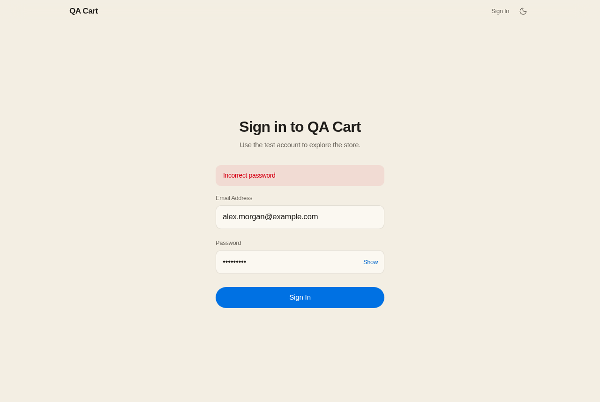 | 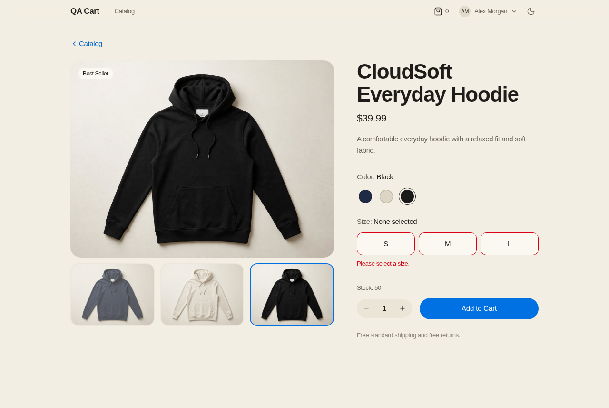 |
| **Added to cart** | **Cart with three lines** |
| 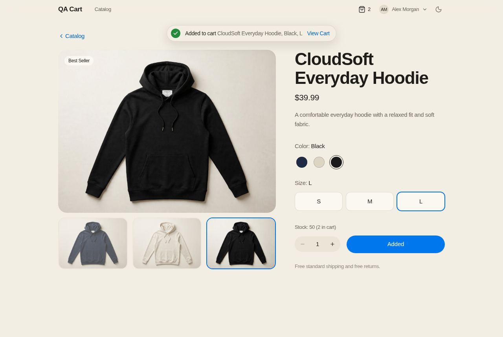 | 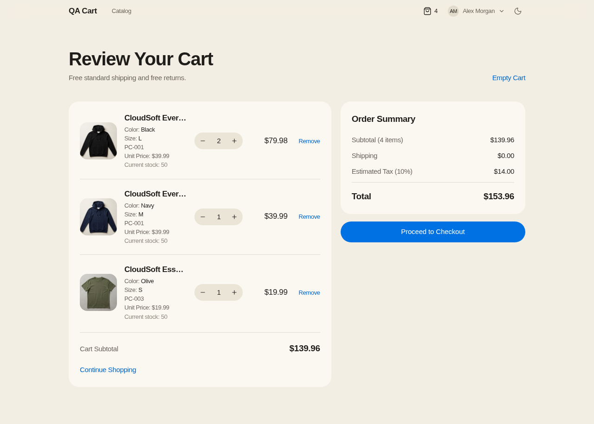 |
| **Checkout** | **Order confirmation** |
| 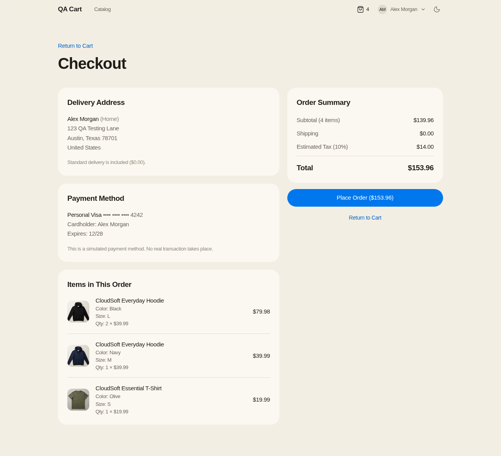 | 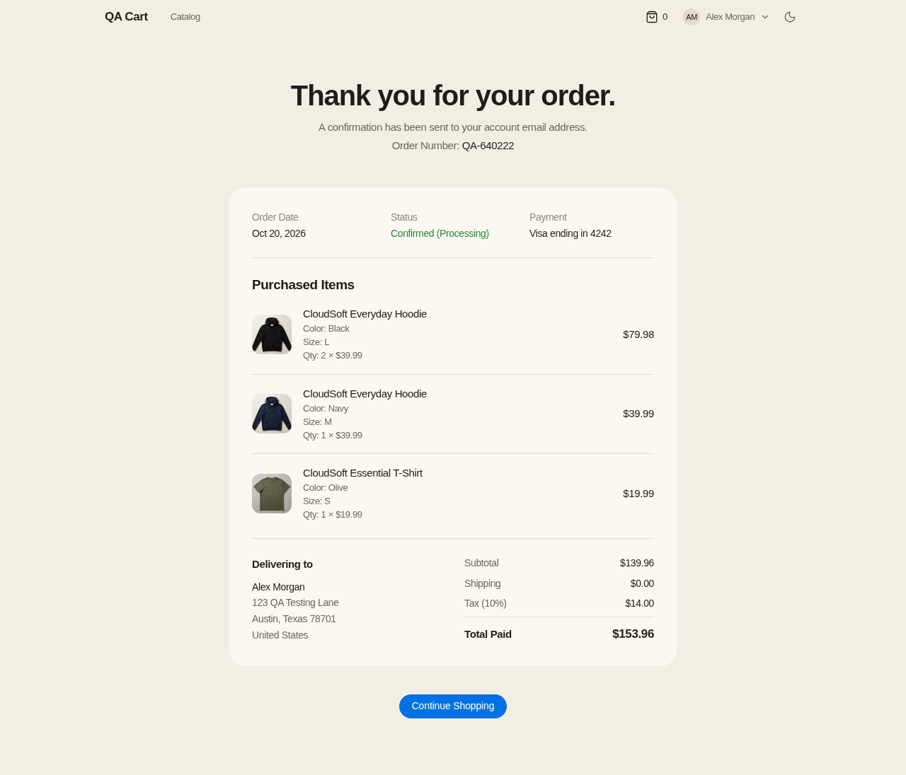 |
| **Empty Cart confirmation** | **Phone** |
| 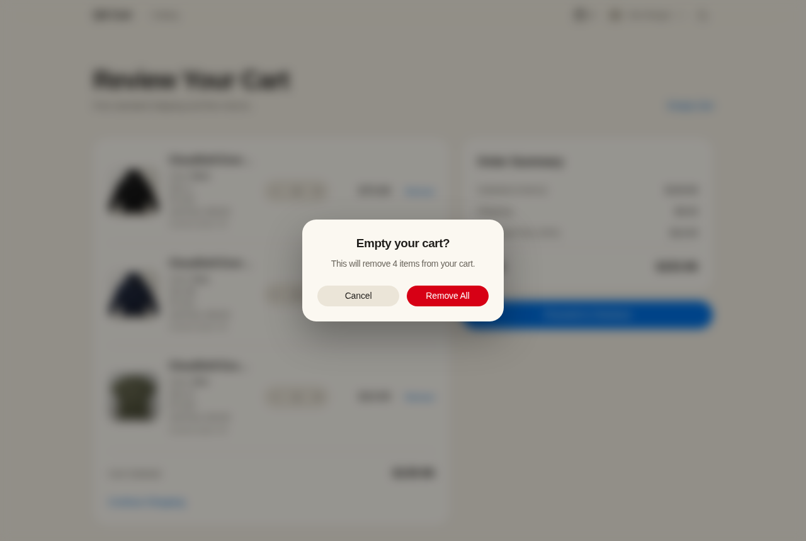 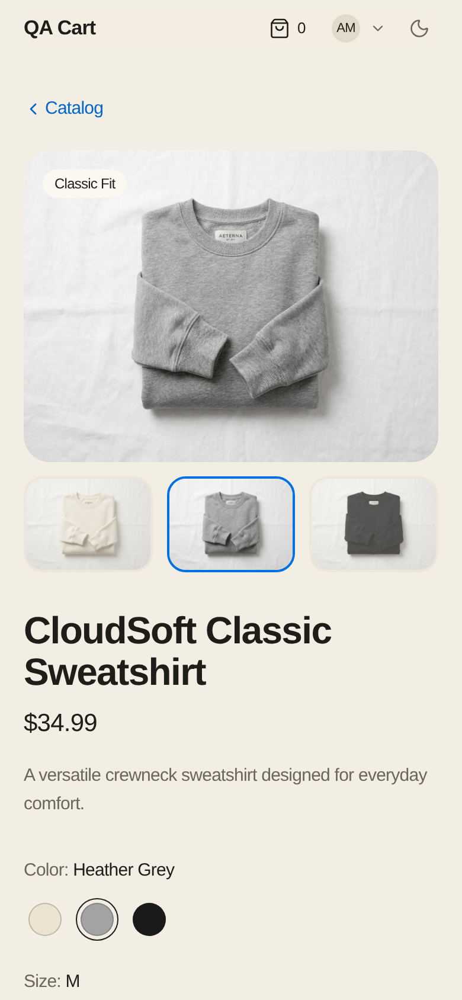 |
| **QA panel** | **Dark mode** |
| 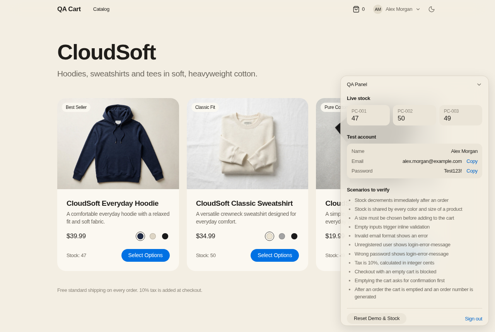 | 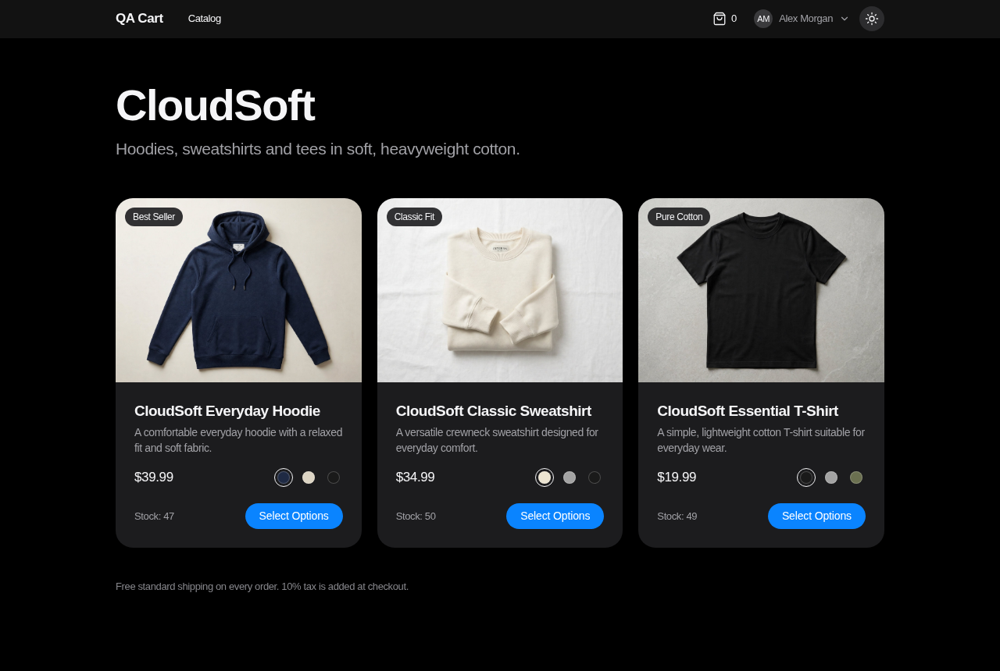 |

The screenshots are taken by Playwright from the `staging` code (see [Automation](#automation)), so they always show the real build.

## How the work flows

Every change follows the same path, and each tool shows where it is.

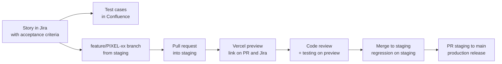

| Step | Jira status | GitHub label | Where it runs |
|---|---|---|---|
| Story is picked up | In Development | `developing` | Local |
| PR opened | Code Review | `ready for code review` | Vercel preview |
| Review passed | Ready To Test | `code review passed`, `ready for testing` | Vercel preview |
| Tests passed | Ready for Staging | `test passed`, `merge to staging` | Vercel preview |
| Merged to `staging` | Test in Staging | `merge to main` | Staging |
| Merged to `main` | Ready for production, then Done | `done` | Production |

## Jira

The Jira project **PIXEL** (PixelCart QA) is a Scrum project with a board, a backlog and two-week sprints.

### Epics

| Epic | Area | Stories |
|---|---|---|
| PIXEL-47 | Login & Session | Sign in, validation, session, protected pages |
| PIXEL-5 | Product Catalog | Catalog grid, stock, product page, sizes, colors, stock per variant, sorting |
| PIXEL-6 | Shopping Cart | Quantities, remove, price math, persistence, color and size per line, Empty Cart confirmation |
| PIXEL-7 | Checkout | Review and place order, new address and card (planned) |
| PIXEL-8 | Order Confirmation | Receipt, stock update, color and size per line |

### Sprints

| Sprint | Dates | Goal |
|---|---|---|
| Sprint 1 (closed) | Oct 2026 | Everything the first version of the app already did: login, catalog, cart, checkout and confirmation (34 points) |
| Sprint 2 (active) | Oct 16 to Oct 30, 2026 | Add the product page with size and color selection, write test cases for every live feature, and automate login with Playwright |

### How issues are organized

- **Stories** are written as *As a / I want / So that* with numbered **acceptance criteria in Given / When / Then**, the `data-testid`s to use and a story point estimate. After a story is built, it is updated to match what was actually delivered.
- **Tasks** are prefixed by type: `[Docs]`, `[Testing]`, `[Automation]`.
- **Subtasks** split each story into `[DEV]`, `[TEST]` and `[DOCS]`, so the board shows that a story isn't finished until it is tested and documented.
- **Bugs** found while testing are logged with the TC ID in the title, steps, expected vs. actual, a screenshot, severity and priority, and are linked to the story.

### Workflow

`To Do` → `In Development` → `Code Review` → `Ready To Test` → `Ready for Staging` → `Test in Staging` → `Ready for production` → `Done`

### Labels

| Kind | Labels |
|---|---|
| Area | `login`, `catalog`, `cart`, `checkout`, `order-confirmation` |
| State | `implemented`, `planned` |
| Work type | `testing`, `regression`, `automation`, `playwright`, `ci`, `documentation` |
| **Test priority** | `test-priority-1-critical`, `test-priority-2-high`, `test-priority-3-medium`, `test-priority-4-low` |

The **test priority** label tells a tester what to test first. Sign-in, adding to the cart, prices and placing an order are always `1-critical`; cosmetic and convenience features are `4-low`.

### GitHub for Jira

The GitHub for Jira app is connected. Because every branch and PR title starts with the Jira key (for example `feature/PIXEL-64-confirm-empty-cart`), the branch, commits, PR and build status appear in the story's **Development** panel. A workflow in this repository also adds the **Vercel preview link** to each story (see [Automation](#automation)).

<!--
Jira screenshots: save them as docs/screenshots/jira-board.png and docs/screenshots/jira-story.png, then remove this comment.
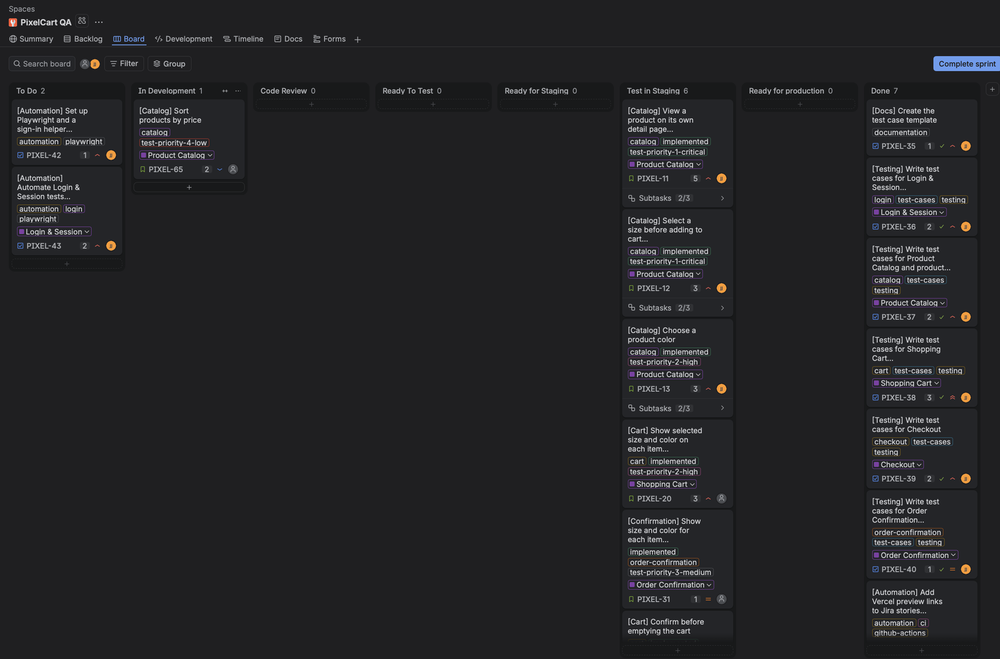
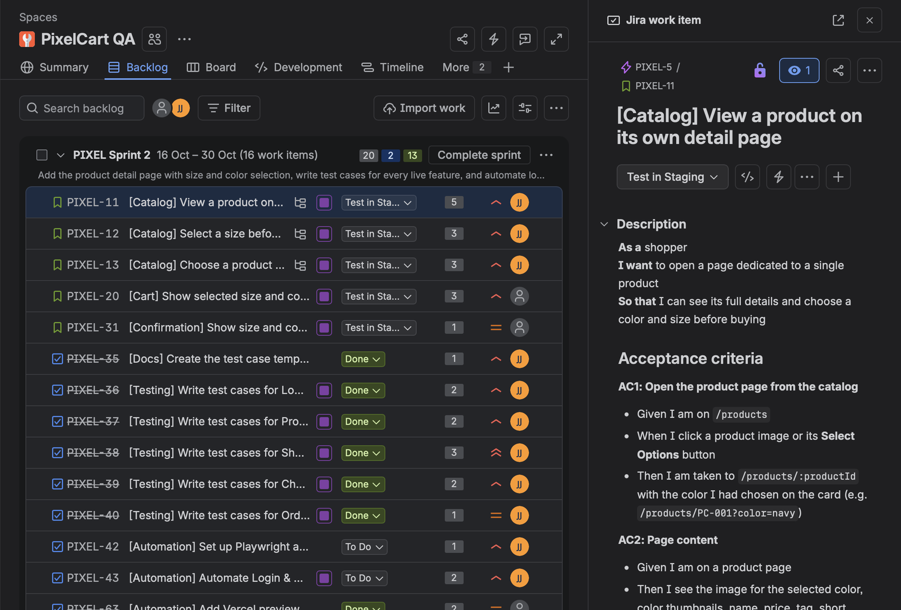
-->

## Confluence

The Confluence space **PIXEL** (PixelCart) is the single source of truth for how the app should behave and how it is tested.

```
PixelCart (space home)
├── Project Overview            purpose, scope, routes, storage keys
├── Environments & Release Flow local, preview, staging, production; branch rules
├── Test Data & State           test user, products, colors, sizes, prices, worked examples, reset
├── Features
│   ├── Login & Session         behavior, business rules L1–L7, messages, test IDs
│   ├── Product Catalog         catalog + product page, rules C1–C13, button states
│   ├── Shopping Cart           rules CA1–CA11, price examples, boundary values
│   ├── Checkout                rules CH1–CH5, messages, planned address and card forms
│   └── Order Confirmation      rules OC1–OC7
└── Test Documentation          scope, counts, approach, how to run
    ├── Test Case Guide         fields, IDs, severity scale, test types, priority labels
    ├── Login & Session Test Cases
    ├── Header, Theme & QA Panel Test Cases
    ├── Product Catalog Test Cases
    ├── Product Page Test Cases
    ├── Shopping Cart Test Cases
    ├── Checkout Test Cases
    ├── Order Confirmation Test Cases
    ├── Cross-Browser & Responsive Test Cases
    └── Regression Test: End-to-End Purchase (TC-REG-001)
```

Every feature page has the same sections: **summary**, **current behavior**, numbered **business rules** (which the test cases refer to, for example "rule CA2"), **messages**, **planned changes** and a **`data-testid` reference**, plus a live table of the epic's Jira stories.

<!--
Confluence screenshots: save them as docs/screenshots/confluence-tree.png and docs/screenshots/confluence-test-cases.png, then remove this comment.

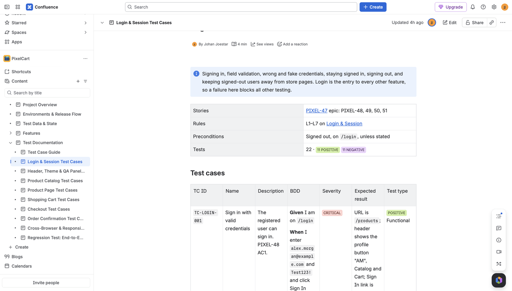
-->

## Test cases

There are **127 manual test cases** (93 positive, 34 negative), written from the acceptance criteria and business rules, plus one end-to-end regression scenario.

| Module | Prefix | Tests | Positive | Negative |
|---|---|---|---|---|
| Login & Session | `TC-LOGIN` | 22 | 11 | 11 |
| Header, Theme & QA Panel | `TC-GEN` | 12 | 11 | 1 |
| Product Catalog | `TC-CAT` | 11 | 9 | 2 |
| Product Page | `TC-PDP` | 24 | 16 | 8 |
| Shopping Cart | `TC-CART` | 27 | 21 | 6 |
| Checkout | `TC-CHK` | 10 | 6 | 4 |
| Order Confirmation | `TC-ORD` | 11 | 9 | 2 |
| Cross-Browser & Responsive | `TC-XB` | 10 | 10 | 0 |
| **Total** | | **127** | **93** | **34** |

Each test case has: **TC ID**, **name**, **description** (with the story and rule it covers), **BDD** (Given / When / Then, one per line), **severity** (Critical, High, Medium, Low), **expected result** (exact text, values and URL) and **test type** (Positive or Negative, plus Functional, Validation, Boundary, Security, Navigation, Persistence, UI, Usability, Accessibility or Compatibility).

An example from the cart:

| TC ID | BDD | Severity | Expected result |
|---|---|---|---|
| `TC-CART-012` | **Given** the cart has Hoodie Navy M and Hoodie Black L<br>**When** I open `/cart`<br>**Then** the summary is correct | Critical | "Subtotal (2 items)" $79.98; Shipping $0.00; "Estimated Tax (10%)" $8.00; Total $87.98 |

**Techniques used:** equivalence partitioning (valid and invalid emails), boundary values (quantity 1, stock − 1, stock, stock 0), error guessing (double clicks, the Back button, two tabs, script and SQL text in inputs) and cross-browser checks on Chrome, Firefox, Safari, Edge, iPhone, Android and tablet.

### Regression: TC-REG-001

One 22-step end-to-end scenario walks through everything a shopper must be able to do: get blocked while signed out, fail with a fake email and a wrong password, sign in, add two hoodies and a T-shirt in different colors and sizes, change the cart, check out, verify the receipt and the stock drop from 50 to 48, and sign out. Every step lists its expected result and the `data-testid` to check. It is the first test to automate and will run in CI on every push.

## GitHub

### Branches

| Branch | Purpose | Deploys to |
|---|---|---|
| `main` | Production, always stable. Nothing is pushed to it directly. | Production |
| `staging` | Integration branch. Every change is merged and regression-tested here first. | Staging |
| `feature/PIXEL-xx-short-name` | One story per branch, created from `staging` | Its own preview |
| `docs/…`, `chore/…` | Documentation and maintenance | Its own preview |

### Pull requests

- The title starts with the Jira key(s): `PIXEL-64: Confirm before emptying the cart`.
- The description lists the stories, what changed, **how to test** step by step and the new test IDs.
- Labels follow the workflow above: `developing` → `ready for code review` → `code review passed` → `ready for testing` → `test passed` → `merge to staging` → `merge to main` → `done`.

| PR | Stories | Status |
|---|---|---|
| #1 | PIXEL-11, 12, 13, 20, 31: product page with size and color selection | Merged to `staging` |
| #2 | PIXEL-63: Vercel preview links on Jira stories | Merged to `staging` |
| #3 | PIXEL-64: confirmation before emptying the cart | Merged to `staging` |
| #4 | PIXEL-63: release of the Jira preview link workflow, branched from `main` with only that change | Merged to `main` |

## Environments on Vercel

| Environment | Branch | URL | Used for |
|---|---|---|---|
| Local | any | http://localhost:3000 | Development and debugging |
| Preview | every branch and PR | `qa-project-git-<branch>-johan-6736.vercel.app` | Reviewing and testing one change on its own |
| Staging | `staging` | https://qa-project-automation-staging.vercel.app | Full regression before a release |
| Production | `main` | https://qa-project-automation.vercel.app | The live app |

Vercel comments the preview link on every pull request. `vercel.json` sends all routes to `index.html`, so refreshing on a page like `/cart` works.

## Automation

| Workflow | File | What it does |
|---|---|---|
| **Jira preview link** | [`.github/workflows/jira-preview-link.yml`](.github/workflows/jira-preview-link.yml) | When a Vercel preview deployment succeeds, it reads the `PIXEL-xx` keys from the branch name and PR title and adds (or updates) a "Vercel preview" web link on each Jira story, so a tester can open the right build straight from the story. Uses the `JIRA_EMAIL` and `JIRA_API_TOKEN` secrets. |
| **README screenshots** | [`.github/workflows/readme-screenshots.yml`](.github/workflows/readme-screenshots.yml) | Builds the app, opens it with Playwright ([`scripts/take-screenshots.mjs`](scripts/take-screenshots.mjs)), takes the screenshots in this README and commits them. |

**Next:** Playwright tests for TC-REG-001 and the module test cases, run on GitHub Actions against each Vercel preview, with the check required before merging into `staging` and `main` (PIXEL-42 to 46, 52, 53).

## Known issues and risks

| Item | Details |
|---|---|
| Two tabs can oversell (TC-CHK-010) | Stock lives in `localStorage` and open tabs don't listen for changes from each other, so two tabs can both order the last 50 hoodies. This test is expected to fail. |
| No thousands separator | Prices of $1,000 or more show as `$1999.50`. The test cases expect what the app shows today. |

## Roadmap

| Story | Change | Status |
|---|---|---|
| PIXEL-64 | Confirm before emptying the cart | On staging |
| PIXEL-65 | Sort the catalog by price | In development |
| PIXEL-14 | Track stock per color and size | Backlog |
| PIXEL-23 to 26 | Add and choose delivery addresses and payment cards at checkout | Backlog |
| PIXEL-30 | Show the chosen address and card on the receipt | Backlog |
| PIXEL-42 to 46, 52, 53 | Playwright automation and CI | Backlog |

## Running it locally

Requires Node.js 20 or later.

```bash
npm install
npm run dev       # http://localhost:3000
npm run build     # production build in dist/
npm run preview   # serve the production build
npm run lint      # type-check with tsc
```

To retake the screenshots locally, build the app, start `npm run preview -- --port 4173`, install Playwright with `npm install --no-save playwright` and run `node scripts/take-screenshots.mjs`.

## Test data

### Registered user
| Field | Value |
|---|---|
| Name | Alex Morgan |
| Email | `alex.morgan@example.com` |
| Password | `Test123!` |

The same credentials are shown, with copy buttons, in the QA panel at the bottom right of every page.

### Saved delivery address and payment method
- Alex Morgan, 123 QA Testing Lane, Austin, Texas 78701, United States
- Personal Visa, `•••• •••• •••• 4242`, expires 12/28 (simulated, no real payment)

### Products (50 units each)
| ID | Name | Price | Colors (ID), first is the default |
|---|---|---|---|
| `PC-001` | CloudSoft Everyday Hoodie | $39.99 | Navy (`navy`), Oatmeal (`oatmeal`), Black (`black`) |
| `PC-002` | CloudSoft Classic Sweatshirt | $34.99 | Cream (`cream`), Heather Grey (`grey`), Black (`black`) |
| `PC-003` | CloudSoft Essential T-Shirt | $19.99 | Black (`black`), Heather Grey (`grey`), Olive (`olive`) |

### Colors, sizes and stock
- Every product has one shared stock of 50, whatever the color or size. Adding 30 navy and 20 black hoodies, in any sizes, uses all 50.
- Every product comes in sizes S (`s`), M (`m`) and L (`l`). A size is chosen on the product page only; the catalog has no quick add.
- There is no default size. Pressing Add to Cart without one shows "Please select a size."
- A cart line is one product in one color and one size. Its ID is `<product id>-<color id>-<size id>`, for example `PC-001-navy-m`.
- A product page can be opened with a color and size: `/products/PC-001?color=black&size=m`. An unknown color falls back to the default, an unknown size means none is selected, and an unknown product shows "Product not found".

### Pricing rules
- Shipping is always $0.00.
- Tax is 10% of the subtotal, rounded to the nearest cent.
- Total = subtotal + shipping + tax, all in integer cents.

| Cart | Subtotal | Tax | Total |
|---|---|---|---|
| 1 × T-Shirt | $19.99 | $2.00 | $21.99 |
| 2 × Hoodie | $79.98 | $8.00 | $87.98 |
| 1 of each product | $94.97 | $9.50 | $104.47 |
| 50 × Hoodie | $1999.50 | $199.95 | $2199.45 |

### Resetting state
Cart, session, stock, last order and theme are stored in `localStorage`. **Reset Demo & Stock** in the QA panel clears the cart, last order and stock, and keeps you signed in. **Sign Out** is in the profile menu (click your initials in the header) and in the QA panel.

## `data-testid` reference

Names follow `<area>-<element>`. Elements that exist once per product end with the product ID (`product-price-PC-001`). Elements that exist once per cart line end with the line ID (`cart-item-PC-001-navy-m`).

<details>
<summary><strong>Header and navigation</strong></summary>

- `brand-logo`: QA Cart wordmark
- `nav-products-link`: Catalog link
- `header-cart-link`, `header-cart-count`: Cart link and number of items
- `header-login-link`: Sign In link (signed out only)
- `header-user-info`: Profile button that opens the menu
- `header-user-menu`, `header-user-menu-name`, `header-user-menu-email`: The open menu and the user's details
- `header-logout-button`: Sign Out item inside the menu
- `theme-toggle`: Switches between light and dark mode
- `toast`, `toast-action`: Notification and its View Cart link
</details>

<details>
<summary><strong>Login (<code>/login</code>)</strong></summary>

- `login-page`, `login-title`, `login-form`
- `login-email-input`, `login-email-error`
- `login-password-input`, `login-password-error`, `login-password-toggle`
- `login-submit-button`
- `login-error-message`: Banner for unknown email or wrong password
</details>

<details>
<summary><strong>Catalog (<code>/products</code>)</strong></summary>

- `products-page`, `products-title`, `product-list`, `catalog-shipping-note`
- Per product: `product-card-<id>`, `product-link-<id>`, `product-image-<id>`, `product-name-<id>`, `product-description-<id>`, `product-price-<id>`, `product-stock-<id>`, `product-in-cart-<id>`, `product-tag-<id>`, `product-sold-out-<id>`, `select-options-<id>`
- Per product and color: `card-color-<id>-<colorId>`, for example `card-color-PC-001-navy`
</details>

<details>
<summary><strong>Product page (<code>/products/:productId</code>)</strong></summary>

- `product-page`, `product-back-link`
- `product-page-image`, `product-thumbnails`, per color `product-thumb-<colorId>`
- `product-page-name`, `product-page-price`, `product-page-description`, `product-page-tag`
- Per color `product-color-<colorId>`; `product-selected-color`
- Per size `product-size-<sizeId>`; `product-selected-size`; `product-size-error`
- `product-page-stock`, `product-page-in-cart`
- `product-quantity-decrease`, `product-quantity-value`, `product-quantity-increase`
- `product-page-add-to-cart`, `product-sticky-bar`, `product-sticky-add-to-cart`
- `product-about`, `product-about-text`
- `product-accordion-<section>`, `product-accordion-panel-<section>` (`details`, `care`, `shipping`); `product-details-list`, `product-care-text`, `product-shipping-text`
- `related-products`
- `product-not-found`, `product-not-found-link`
</details>

<details>
<summary><strong>Cart (<code>/cart</code>)</strong></summary>

- `cart-page`, `cart-title`, `cart-subtitle`, `cart-items-list`, `cart-subtotal`
- `cart-clear-button`: Empty Cart, opens the confirmation dialog
- `empty-cart-dialog`, `empty-cart-dialog-title`, `empty-cart-dialog-message`, `empty-cart-dialog-cancel-button`, `empty-cart-dialog-confirm-button`, `empty-cart-dialog-backdrop`: "Empty your cart?" dialog. Remove All empties the cart and shows "Cart emptied"; Cancel, Escape or a click outside keeps it
- `cart-empty-state`, `cart-empty-message`, `continue-shopping-button`
- `proceed-to-checkout-button`
- Per line: `cart-item-<line>`, `cart-item-image-<line>`, `cart-item-name-<line>`, `cart-item-color-<line>`, `cart-item-size-<line>`, `cart-item-sku-<line>`, `cart-item-unit-price-<line>`, `cart-item-stock-<line>`, `cart-item-quantity-<line>`, `cart-item-subtotal-<line>`, `increase-quantity-<line>`, `decrease-quantity-<line>`, `remove-item-<line>`
</details>

<details>
<summary><strong>Checkout (<code>/checkout</code>)</strong></summary>

- `checkout-page`, `checkout-title`
- `checkout-delivery-address`, `checkout-delivery-note`
- `checkout-payment-method`, `checkout-payment-note`
- `checkout-items-list`, `checkout-empty-items-message`
- Per line: `checkout-item-<line>`, `checkout-item-color-<line>`, `checkout-item-size-<line>`, `checkout-item-quantity-<line>`, `checkout-item-subtotal-<line>`
- `checkout-order-summary`, `checkout-subtotal-label`, `checkout-subtotal`, `checkout-shipping`, `checkout-tax`, `checkout-total`
- `place-order-button`
- `checkout-error-message`, `checkout-go-to-catalog-link`
- `return-to-cart-link` (top), `return-to-cart-button` (below the summary)
</details>

<details>
<summary><strong>Order confirmation (<code>/order-confirmation</code>)</strong></summary>

- `order-confirmation-page`, `order-confirmation-title`
- `order-confirmation-number`: `QA-` followed by six digits
- `order-confirmation-date`, `order-confirmation-status`, `order-confirmation-payment`
- `order-confirmation-items`, per line `confirmed-item-<line>`, `confirmed-item-color-<line>`, `confirmed-item-size-<line>`
- `order-confirmation-address`
- `order-confirmation-subtotal`, `order-confirmation-shipping`, `order-confirmation-tax`, `order-confirmation-total`
- `continue-shopping-after-order-button`
</details>

<details>
<summary><strong>QA panel</strong></summary>

- `qa-helper-toggle`, `qa-helper-panel`
- Per product: `qa-stock-<id>`
- `qa-user-name`, `qa-user-email`, `qa-user-password`
- `qa-copy-email-button`, `qa-copy-password-button`
- `qa-reset-state-button`: Resets cart, last order and stock (keeps the session and theme)
- `qa-logout-button`
</details>

## Project structure

```
.github/workflows/  jira-preview-link.yml, readme-screenshots.yml
docs/screenshots/   README images, generated by Playwright
scripts/            take-screenshots.mjs
src/
  assets/           images/ (one photo per product and color)
  components/       Navbar, ProductCard, CartItemRow, OrderSummary, QAHelperDrawer,
                    ProtectedRoute, Reveal, ScrollToTop, ColorSwatches, SizeSelector, Accordion,
                    ConfirmDialog
  context/          AuthContext, CartContext, ThemeContext, ToastContext
  hooks/            useRadioGroupKeys (arrow keys for swatches and sizes)
  data/             mockUser.ts (test user, address, card), products.ts
  pages/            Login, Products, Product, Cart, Checkout, OrderConfirmation
  types/            Shared TypeScript types
  utils/            currency.ts (cent math), validation.ts, storage.ts
```

## License

Released under the [MIT License](LICENSE).
